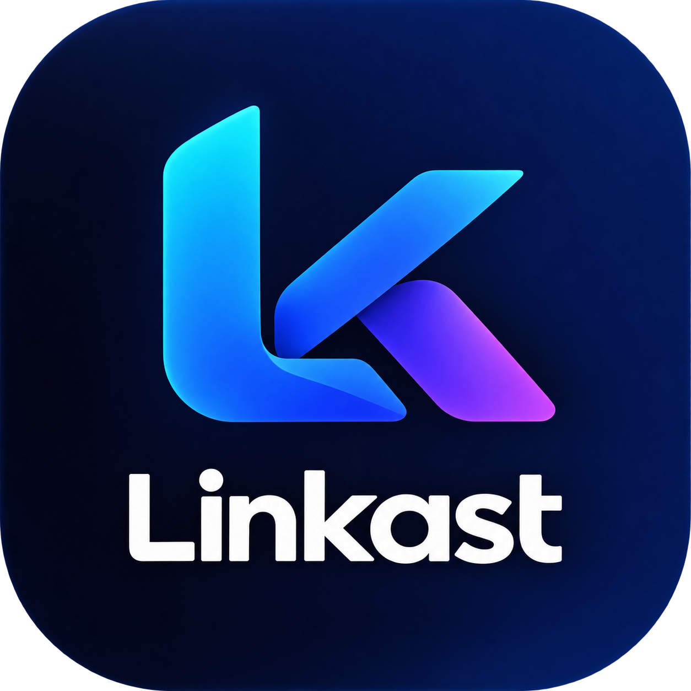
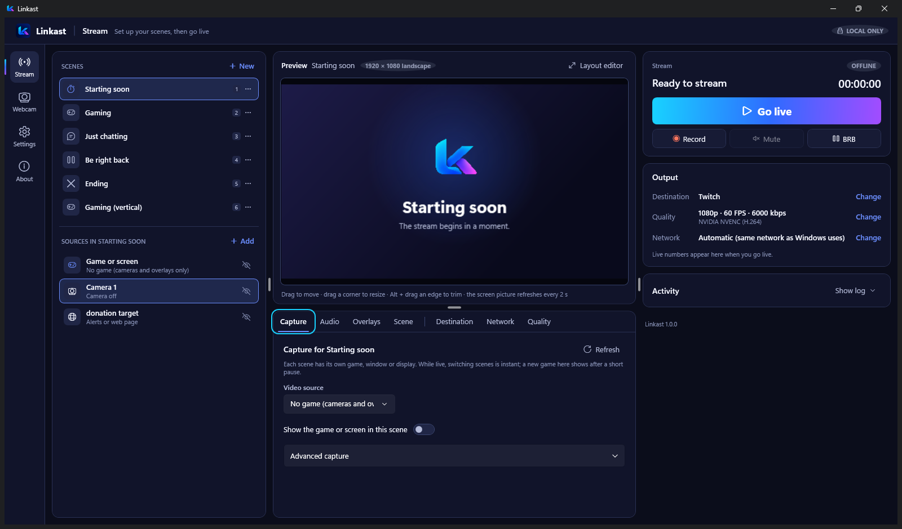
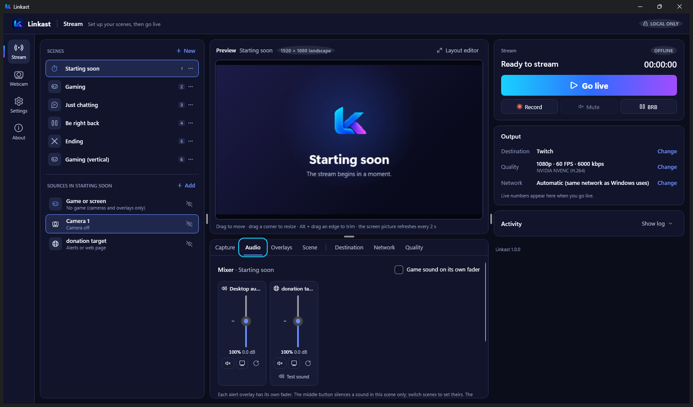
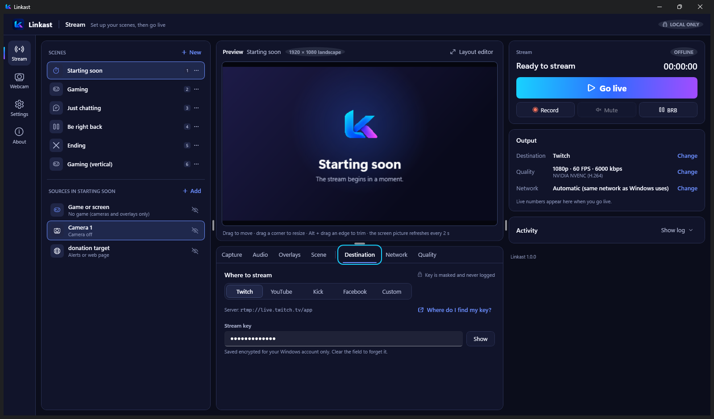
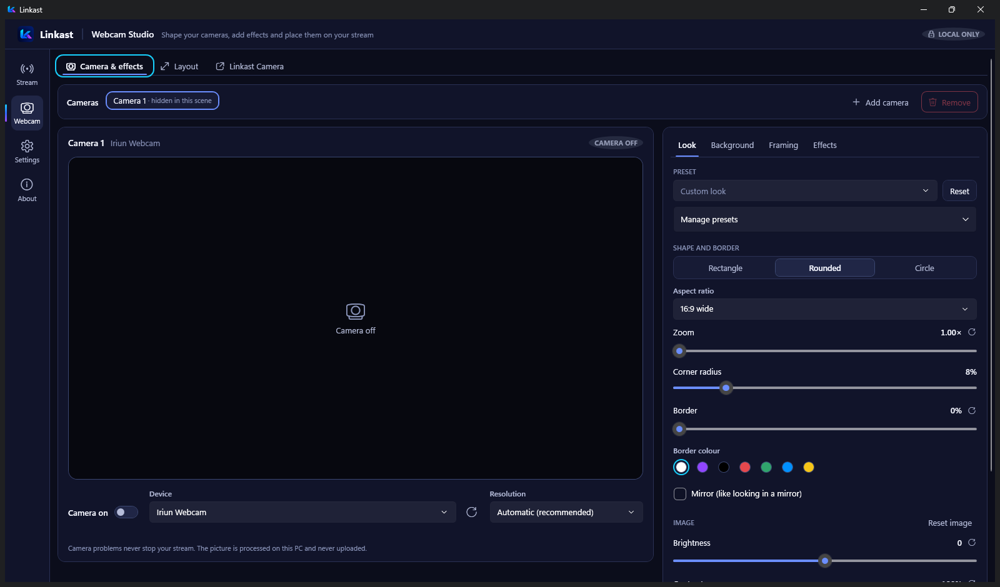
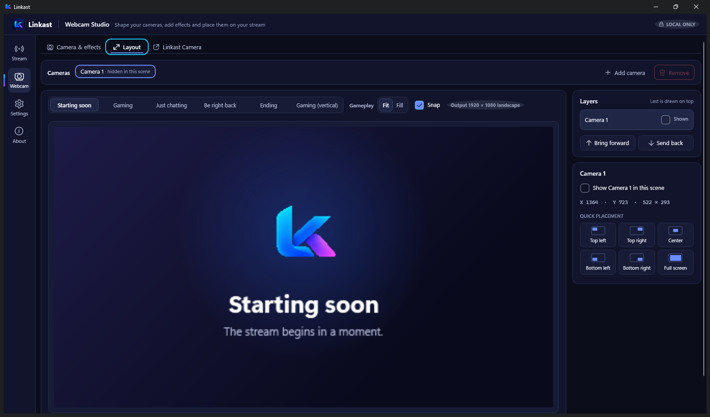
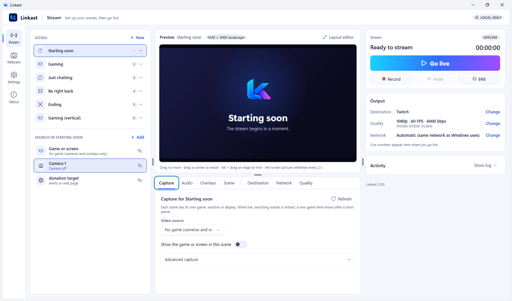

<p align="center">
  
</p>

<h1 align="center">Linkast: a free, open-source OBS alternative for Windows</h1>

<p align="center">
  <b>Lightweight live streaming software for Twitch, YouTube, Kick, Facebook and any RTMP server.</b><br>
  Scenes, an audio mixer, alerts, webcam effects and recording, in an app you can learn in minutes.
</p>

<p align="center">
  <a href="https://github.com/DASaBeR/Linkast/releases/latest"></a>
  <a href="LICENSE"></a>
  
</p>

<p align="center">
  
</p>

**Linkast** is a free and open-source **live streaming app for Windows**. It captures your game, a window or your whole screen, adds your webcam, alerts and overlays, mixes your sound, and streams to **Twitch, YouTube, Kick, Facebook** or any **RTMP/RTMPS** server, while recording to your PC if you want. Encoding runs locally with FFmpeg on your NVIDIA, AMD or Intel GPU, with an x264 fallback.

It is made for streamers who find OBS Studio too complicated: fewer settings, clear errors, and a setup checklist that tells you exactly what is missing before you go live. It is also the only streaming tool that lets you **choose which network connection your stream uses**, for example your phone's 5G for the stream while your game stays on Ethernet.

**[Download Linkast for Windows](https://github.com/DASaBeR/Linkast/releases/latest)**: free, no account, no ads, no telemetry.

## Features

### Streaming and scenes

- **Go live in a few clicks.** Pick Twitch, YouTube, Kick or Facebook and paste your stream key; the server is filled in for you. Custom RTMP and RTMPS servers and restream services work too.
- **Scenes that switch instantly while live:** Starting soon, Gaming, Just chatting, Be right back and Ending are ready to use, and you can add your own. Each scene has its own game or screen, cameras, overlays, background (a branded card, a picture or a looping video) and sounds.
- **Starting soon and Ending automation:** Go live can start on your Starting soon scene, and End stream can show a goodbye scene first and then end by itself.
- **Game capture, window capture and screen capture** with Windows Graphics Capture or Desktop Duplication, and a warning with a one-click fix when a game would capture as black.
- **Record to your PC** alone or while streaming, with a single encode for both. Recordings are crash-safe MKV, with an optional MP4 copy.
- **Find the best settings:** Linkast tests your encoders and your upload speed, then suggests resolution, frame rate and bitrate.
- **Import from OBS Studio:** your server and key, quality, capture, cameras, alerts, pictures, audio, recordings and network adapter, item by item.

### Alerts, overlays and audio

- **Stream alerts and overlays** from Streamlabs, StreamElements, Reymit or any alert service: paste the same link you would give OBS as a Browser Source. Add your logo or any picture. Move, resize and trim them live.
- **Audio mixer** like OBS: a fader, mute and level meter for desktop audio, your microphone, the game on its own, every alert and every scene video, with **Test sound** for alerts.
- **Microphone noise removal** and mute that work while live, without restarting the stream.
- **Global hotkeys** that work in fullscreen games: go live, mute, cameras, Be right back, record and switch scenes with Ctrl+Alt+1 to 9.

<p align="center">
  
  
</p>

### Webcam Studio: background blur and auto-framing without a green screen

- **Blur, remove or replace your webcam background** with a local AI model on your graphics card (DirectML) or CPU. No green screen, and your camera picture never leaves your PC.
- **Auto-framing** keeps your face in the picture smoothly, using Windows' own face detection.
- **Shape and style your camera:** rectangle, rounded or circle, borders, animated borders, glow and effects that react to your voice.
- **Picture controls:** brightness, contrast, saturation, sharpening, noise reduction, low-light boost, and your camera's own exposure, focus and white balance.
- **Up to four cameras**, each with its own look, placed exactly where you want in a layout editor that matches the stream pixel for pixel.
- **Vertical streaming (9:16)** for TikTok, YouTube Shorts and Instagram Reels, next to landscape (16:9) for Twitch and YouTube.
- **Linkast Camera** (Windows 11): use your Linkast look as a virtual webcam in Zoom, Microsoft Teams, Discord, Google Meet or OBS.
- **Use your phone as a webcam** with Iriun, DroidCam, Camo or Windows 11's connected camera; see [docs/phone-as-webcam.md](docs/phone-as-webcam.md).

<p align="center">
  
  
</p>

## What makes Linkast different

- **You pick the network for your stream.** Play over Ethernet and stream over a tethered phone, a 5G modem or a second ISP, or the other way round. Only Linkast's stream uses the network you choose; your game keeps Windows' normal route. Linkast verifies the network actually used, never switches on its own, and never changes Windows network settings. **Test connection** shows which network really reached your server.
- **Honest stream health.** Linkast only says *Live* when frames are being encoded **and** reaching the server, measured on the real connection: frame rate, upload, encoder speed, dropped frames and reconnects.
- **Errors that tell you how to fix them.** Capture, audio, encoding, network and settings problems are reported separately, in plain language, with a button that opens the setting that fixes it.
- **Local only and private.** No account, no cloud, no telemetry. Your stream goes straight from your PC to the server you choose. Your stream key is saved encrypted, masked in the app and removed from every log.
- **Bounded reconnect.** Network drops are retried with backoff, a limited number of times.

## Linkast vs OBS Studio

| | Linkast | OBS Studio |
|---|---|---|
| Price and licence | Free, open source (GPL-3.0) | Free, open source (GPL-2.0) |
| Platforms | Windows 10 and 11 | Windows, macOS, Linux |
| Learning curve | A few minutes; a checklist shows what is missing before you go live | Powerful, with many more settings to learn |
| Scenes, audio mixer, alerts, recording | Yes | Yes |
| Webcam background blur and removal | Built in on any GPU or CPU, no green screen | NVIDIA RTX filter or plugins |
| Auto-framing for your face | Built in | Through plugins |
| Choose the network the stream uses | Built in, verified on the real connection | No |
| Transitions, plugins and filters per source | No; Linkast stays small | Yes |
| Bring your OBS settings over | One-click import from OBS | — |

Linkast does not try to replace every OBS feature. If you need transitions, plugins or a full production studio, OBS is the better tool. If you want to stream a game with your camera and alerts and not think about the software, Linkast is made for you.

<p align="center">
  
</p>

## Download and install

1. Download **`LinkastApp-win-Setup.exe`** from the [latest release](https://github.com/DASaBeR/Linkast/releases/latest).
2. Run it. It installs for your Windows account only, needs no admin rights, and adds Start-menu and Desktop shortcuts. A portable zip is attached to each release too.
3. Choose your platform, paste your stream key, and press **Go live**.

Linkast is not code-signed yet, so Windows SmartScreen may warn: choose *More info* › *Run anyway*.

Linkast looks for a newer version once when it starts and when you press **Check for updates**. A new version is only mentioned next to that button and installs only when you press **Update now**. Nothing else is ever sent.

### Requirements

- Windows 10 version 1903 or later, or Windows 11, 64-bit.
- An NVIDIA (NVENC), AMD (AMF) or Intel (Quick Sync) GPU is recommended for hardware encoding. Software x264 encoding is always available.
- Linkast Camera (the virtual webcam) needs Windows 11.

## FAQ

**Is Linkast a free OBS alternative?**
Yes. Linkast is free and open source under the GPL, with no paid tier, account or ads. It covers what most streamers use in OBS (scenes, sources, an audio mixer, alerts, webcam and recording) with far fewer settings.

**Can I stream to Twitch, YouTube and Kick with Linkast?**
Yes. Twitch, YouTube, Kick and Facebook are built in; pick one and paste your stream key. Any other RTMP or RTMPS server works too, including restream services that send your stream to several platforms at once.

**Does Linkast work with Streamlabs and StreamElements alerts?**
Yes. Paste the same alert box or overlay link you would add to OBS as a Browser Source. Each alert gets its own volume fader and a test-sound button.

**Can I blur my webcam background without a green screen?**
Yes. Webcam Studio blurs, removes or replaces your background with a local AI model on your PC. Nothing is uploaded.

**Can I stream over mobile data or a second internet connection?**
Yes, and this is what Linkast was built for. Choose the network for your stream on the Network tab, for example a tethered phone or a 5G modem, while your game and other apps keep using your normal connection.

**Can I record without going live?**
Yes. Press **Record** to save to a file on your PC, or turn on *Also record when I go live* to keep a copy of every stream.

**Does Linkast collect any data?**
No. There is no account, no cloud and no telemetry. The only network traffic besides your stream is the update check on GitHub and the web overlays you add yourself.

**Does Linkast run on macOS or Linux?**
Not at the moment. Linkast uses Windows capture, audio and camera APIs and runs on Windows 10 and 11.

## Building from source

Prerequisites: the [.NET 10 SDK](https://dotnet.microsoft.com/download) and FFmpeg. Releases bundle a pinned FFmpeg 9.0.1 "essentials" build from [gyan.dev](https://www.gyan.dev/ffmpeg/builds/); `tools/fetch-ffmpeg.ps1` downloads and verifies exactly that build.

```powershell
powershell -ExecutionPolicy Bypass -File tools/fetch-ffmpeg.ps1   # pinned FFmpeg, hash-verified
$env:LINKAST_FFMPEG = "$PWD\artifacts\ffmpeg\9.0.1\ffmpeg.exe"
powershell -ExecutionPolicy Bypass -File tools/fetch-models.ps1   # background-effect model, hash-verified
dotnet build Linkast.slnx -c Release
dotnet run --project src/Linkast.App
```

To build the app folder and zip, plus the installer and update packages with `-Installer` (all into `artifacts/`):

```powershell
powershell -ExecutionPolicy Bypass -File tools/publish.ps1 -Installer
```

Releases are built by GitHub Actions; see [docs/releasing.md](docs/releasing.md).

Linkast looks for FFmpeg in this order: the `LINKAST_FFMPEG` environment variable, `ffmpeg\ffmpeg.exe` next to `Linkast.exe`, then `PATH`.

## Running the tests

```powershell
dotnet test Linkast.slnx
```

Unit tests always run. Integration tests stream to a real local RTMP server and are skipped unless it is running:

```powershell
docker compose -f tools/test-ingest/docker-compose.yml up -d
dotnet test tests/Linkast.IntegrationTests
```

## Project layout

| Path | Purpose |
|---|---|
| `src/Linkast.Core` | Domain model, engine interface, state machine, validation, redaction. No Windows dependencies. |
| `src/Linkast.Engine.FFmpeg` | FFmpeg location, encoder probing, argument building, process supervision, progress and error parsing. |
| `src/Linkast.Networking` | Local relay that owns the outgoing connection and measures it. |
| `src/Linkast.Platform.Windows` | Display/window enumeration, WASAPI audio capture, WinRT camera capture and the camera layer pipe. |
| `src/Linkast.App` | WPF user interface. |
| `docs/` | Architecture, decisions, risks, licensing, roadmap. |

Start with [docs/architecture.md](docs/architecture.md). Contributions are welcome; see [CONTRIBUTING.md](CONTRIBUTING.md).

## License

Linkast is free software, licensed under the [GNU General Public License v3.0 or later](LICENSE). It runs FFmpeg as a separate program; see [THIRD-PARTY-NOTICES.md](THIRD-PARTY-NOTICES.md) and [docs/licensing.md](docs/licensing.md).
